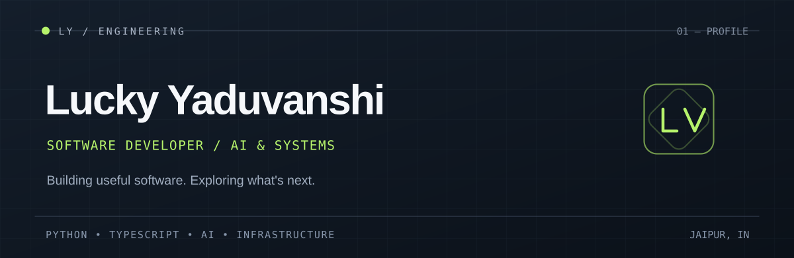

  

# Lucky Yaduvanshi

**Software Developer · AI Tools · Backend Systems**

I build practical software at the intersection of artificial intelligence, backend engineering, and modern web development.

Focused on tools that are useful, efficient, and thoughtfully engineered.

[Portfolio](https://luckyyaduvanshi.in) · [LinkedIn](https://www.linkedin.com/in/lucky-yaduvanshi/) · Jaipur, India

---

## Selected projects

### [CodaiPro ↗](https://github.com/Luckyyaduvanshiofficial/Codaipro)

Offline AI coding assistant powered by llama.cpp, designed for local execution and portable workflows.

`Python` / `llama.cpp` / `JavaScript`

### [Prowriter ↗](https://github.com/Luckyyaduvanshiofficial/Prowriter)

AI content creation platform integrating multiple models, writing workflows, and content management.

`Next.js` / `TypeScript` / `Appwrite`

### [MiniAI ↗](https://github.com/Luckyyaduvanshiofficial/miniai-swe)

Exploring agentic application generation, AI workflows, and full-stack development.

`Next.js` / `tRPC` / `PostgreSQL`

---

## Toolbox

Python · FastAPI · TypeScript · React · Next.js · PostgreSQL · Docker · Linux · GitHub Actions

## Current interests

Local-first AI, agentic developer tools, API infrastructure, self-hosting, and open-source software.

---

Have something interesting in mind?
[Let's connect ↗](https://www.linkedin.com/in/lucky-yaduvanshi/)
